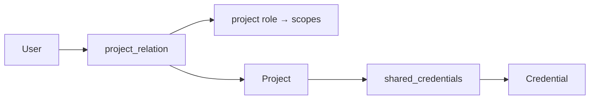

# Global credentials — implementation plan

Status: draft. Scope of change: replace per-user credentials with
instance-wide (global) credentials.

This document plans a change to the credential system. Today each
credential belongs to a project, usually the personal project of one
user. The goal: credentials are global. They belong to the instance.
Every user can see, use, create, edit, and delete them.

Baseline: `n8n@2.49.7` (current checkout: package version `2.50.0`).

## Decisions

The product owner made two decisions. The plan follows them.

1. **Replace, do not extend.** Global credentials replace per-user
   credentials. Personal and project-owned credentials migrate to global
   on upgrade. New credentials are global by default. The change needs a
   data migration.
2. **Everyone manages.** Any authenticated user can create, edit, and
   delete global credentials. No admin-only management. The credential
   sharing UI and its scopes go away.

## How credentials work today

### Data model

The credential row lives in `credentials_entity`
(`packages/@n8n/db/src/entities/credentials-entity.ts`). Relevant columns:

- `id`, `name`, `type` — identity and credential type.
- `data` — the secret payload, encrypted.
- `usageScope` — `'project'` or `'instance'`.
- `isGlobal` — boolean flag, default false.
- `isResolvable` — marks a private (end-user) credential.
- `isManaged`, `pendingAuthorizationExpiresAt` — lifecycle flags.

Ownership and sharing live in `shared_credentials`
(`packages/@n8n/db/src/entities/shared-credentials.ts`). Each row links a
credential to a project with a role:

- `credential:owner` — the owning project. Usually the personal project
  of the user that created the credential.
- `credential:user` — projects the credential is shared with.

Users relate to projects through `project_relation`, which carries the
project role (owner, admin, editor, viewer, chat user). The role grants
scopes. Project scopes for credentials are defined in
`packages/@n8n/permissions/src/roles/scopes/project-scopes.ee.ts`:
`credential:create`, `credential:read`, `credential:update`,
`credential:delete`, `credential:list`, `credential:share`,
`credential:unshare`, `credential:move`, `credential:connect`,
`credential:createEndUser`.

### Access resolution

Access follows the chain:

The key access paths:

- `SharedCredentialsRepository.buildSharedCredentialIdsSubquery()`
  (`packages/@n8n/db/src/repositories/shared-credentials.repository.ts`)
  builds the "credentials visible to this user" subquery. It joins
  `shared_credentials → project → project_relation → role → scope`.
  Special cases exist for personal project, `onlySharedWithMe`, and
  users with the global `credential:read` scope.
- `SharedCredentialsRepository.findPairsWithCredentialAccess()` checks
  (credential, user) pairs against a scope through the same join chain.
- `CredentialsFinderService`
  (`packages/@n8n/backend-services/src/credentials/credentials-finder.service.ts`)
  answers "can this user access this credential with these scopes".
- `CredentialsPermissionChecker`
  (`packages/cli/src/executions/pre-execution-checks/credentials-permission-checker.ts`)
  runs before each workflow execution. It verifies the workflow's
  credentials are accessible to the user that started the run.

### What `isGlobal` does today

`isGlobal` is a partial escape hatch from per-user ownership:

- `CredentialsRepository.findGlobalProjectCredentialIds()`
  (`packages/@n8n/db/src/repositories/credentials.repository.ts:150`)
  filters credential IDs down to the global ones, "which every project
  can use". The execution permission check accepts global credentials
  for any project.
- The list query accepts `includeGlobal`. It adds
  `OR credential.isGlobal = true` to the sharing filter
  (`credentials.repository.ts:717`).
- Changing `isGlobal` requires the sharing license feature and the
  global scope `credential:shareGlobally`
  (`packages/cli/src/credentials/credentials.controller.ts:407-421`).
- A partial index (`IDX_..._credentials_entity_is_global`,
  migration `1784000000044-AddPartialIndexForGlobalCredentials.ts`)
  exists because the permission check fetches all global credential IDs
  before every workflow execution.

A global credential is still owned by a project. Only its **use** in
workflows is open to everyone. Management (read data, update, delete,
share) still follows the ownership chain above.

### Creation and ownership assignment

`CredentialsService.createUnmanagedCredential()`
(`packages/cli/src/credentials/credentials.service.ts:2168`) creates the
row and inserts a `credential:owner` row for the user's personal project
(or the `projectId` from the request) through
`CredentialsRepository.insertProjectCredentialWithOwner()`
(`credentials.repository.ts:75`).

### Instance credentials are a separate mechanism

Rows with `usageScope: 'instance'` are provider connections. They have
no `shared_credentials` rows. Workflows cannot use them. Only trusted
backend features use them, through `InstanceCredentialBroker`
(`packages/cli/src/credentials/instance-credentials.md`). Owners and
admins manage them with the global scope `credential:manageInstance`.

They are out of scope for this change. Do not merge the two models.

### Frontend

- `useCredentialsStore.fetchAllCredentials()`
  (`packages/frontend/editor-ui/src/features/credentials/credentials.store.ts:363`)
  loads credentials for a project scope. `includeGlobal` defaults to
  true.
- `createNewCredential()` (`credentials.store.ts:485`) passes
  `projectId` and optional `isGlobal`.
- The sharing modal (`CredentialSharing.ee`), the move modal, and the
  "shared with me" filters implement per-user semantics in the UI.
- The credential picker filters credentials by workflow/project scope.

### Adjacent subsystems that assume per-user ownership

These touchpoints reference ownership or sharing and need review:

- OAuth callback flow (`packages/cli/src/oauth/oauth.service.ts`) —
  token storage for the credential.
- Source control export/import
  (`packages/cli/src/modules/source-control.ee/source-control-export.service.ee.ts`,
  `source-control-import.service.ee.ts`) — exports credentials with
  ownership metadata.
- Public API
  (`packages/cli/src/public-api/v1/controllers/credentials.public.controller.ts`).
- Import/export CLI (`packages/cli/src/commands/import/credentials.ts`).
- User reset command
  (`packages/cli/src/commands/user-management/reset.ts`) reassigns all
  credentials to the instance owner's personal project and re-attaches
  dangling credentials.
- Credential transfer endpoints (`/transfer`, `/transfer-preview` in
  `credentials.controller.ts`) move credentials between projects.
- MCP tools (`packages/cli/src/modules/mcp/tools/list-credentials.tool.ts`).
- Dynamic credentials (private, `isResolvable`) —
  `packages/cli/src/modules/dynamic-credentials.ee/`. These are
  per-user by design. See "Out of scope" below.
- Telemetry events: `credentials-shared`, `credentials-created` with
  `projectId`/`projectType`, and the audit events
  `credentials-data-read`, `credentials-list-data-read`.
- Security audit credential risk reporter
  (`packages/cli/src/security-audit/risk-reporters/credentials-risk-reporter.ts`).

## Target design

### Data model

- Every credential with `usageScope: 'project'` becomes global:
  `isGlobal = true`.
- A global credential has **no owner requirement**. The access layer
  must not depend on a `credential:owner` row. Code that assumes an
  owning project must handle the global case.
- `shared_credentials` rows for workflow credentials become obsolete.
  Keep them during rollout for rollback. Remove them in a cleanup
  migration after the access layer no longer reads them.

### Access control

Every authenticated user gets the full credential scope set:

- Read, list: all global credentials. `buildSharedCredentialIdsSubquery`
  and the `CredentialsFinderService` stop filtering by project
  membership for global credentials.
- Create, update, delete: allowed for any authenticated user. The
  `credential:shareGlobally` gate in `PATCH /credentials/:id` goes away.
- Use in workflows: `CredentialsPermissionChecker` accepts global
  credentials for any user. This already works through
  `findGlobalProjectCredentialIds`; it becomes the only path.

Scopes to remove or make unconditional: `credential:share`,
`credential:unshare`, `credential:move`, `credential:shareGlobally`.
Keep `credential:connect` and `credential:createEndUser` if private
credentials stay (see below).

### API and UI

- `GET /credentials` returns all global credentials for every user.
  The `onlySharedWithMe`, `includeGlobal`, and project filters become
  no-ops.
- `POST /credentials` sets `isGlobal: true` and inserts no owner row.
  The `projectId` request field is ignored for ownership (kept for
  telemetry or dropped).
- `PUT /credentials/:id/share`, `/transfer`, `/transfer-preview` are
  removed or return 410 Gone. Their UI (sharing modal, move modal) is
  removed.
- The credentials view shows one flat list of all credentials. The
  picker offers all credentials.
- User-facing text (i18n in `@n8n/i18n`) loses "sharing" language.

## Work items

### Phase 1 — access layer (backend)

1. `CredentialsFinderService`: grant read on any global credential to
   any authenticated user, with full scopes.
2. `SharedCredentialsRepository.buildSharedCredentialIdsSubquery`: for
   global credentials, skip the project-join filters.
3. `CredentialsPermissionChecker`: accept `isGlobal` credentials
   unconditionally. Keep the check for non-global rows during rollout.
4. `CredentialAccessRepository` (`packages/@n8n/db/src/repositories/credential-access.repository.ts`):
   same treatment for pair checks.
5. Extend unit tests in
   `packages/@n8n/backend-services/src/credentials/__tests__/credentials-finder.service.test.ts`
   and the access-repository tests.

### Phase 2 — write paths (backend)

1. `createUnmanagedCredential`: force `isGlobal: true`, skip the owner
   row insert. Adjust `insertProjectCredentialWithOwner` or add a
   `insertGlobalCredential` method.
2. `PATCH /credentials/:id`: drop the license and `credential:shareGlobally`
   gates. `isGlobal` is always true; reject attempts to set it false.
3. `DELETE /credentials/:id`: allow for any user on a global credential.
4. Remove or stub the share/transfer endpoints in
   `credentials.controller.ts`. Remove `EnterpriseCredentialsService`
   sharing logic that only serves per-user sharing.
5. OAuth, test, and probe endpoints: replace the ownership lookup with
   a global lookup.
6. User reset command (`reset.ts`): stop reassigning credentials to the
   owner's personal project. Global credentials survive user deletion.
   Remove the dangling-credential repair for global rows.

### Phase 3 — data migration

One migration in `packages/@n8n/db/src/migrations/common/`:

1. `UPDATE credentials_entity SET "isGlobal" = true WHERE "usageScope" = 'project'`.
2. Keep `shared_credentials` rows for rollback.

Follow-up cleanup migration (later release):

3. Delete `shared_credentials` rows whose credential is global and
   unused by remaining features. Verify `getSharedPersonalCredentialsCount`
   and similar metrics first.

Rollback: the `down` of the data migration restores nothing — the old
sharing rows still exist, so setting `isGlobal = false` restores the old
visibility model. Document this.

Note: `findDanglingProjectCredentials` and
`findProjectCredentialWithoutOwner` treat ownerless project credentials
as anomalies. Global credentials will be ownerless by design. Adjust
both to exclude or accept global rows.

### Phase 4 — frontend

1. Remove the credential sharing modal, move modal, and "shared with me"
   filters.
2. Credentials view: one flat list. Remove home-project and shared-with
   columns for credentials.
3. `fetchAllCredentials`: drop `projectId`, `onlySharedWithMe`,
   `includeGlobal` handling. The picker lists all credentials.
4. Remove scopes-driven disabling of edit/delete on credential cards.
5. Update i18n strings in `@n8n/i18n`.

### Phase 5 — adjacent subsystems

1. Source control: export credentials without ownership metadata. On
   import, create global credentials.
2. Public API: list/create operate on global credentials. Check the
   `credential-public.dto.ts` schema for ownership fields.
3. CLI import (`commands/import/credentials.ts`): create global
   credentials, no owner row.
4. MCP `list-credentials.tool.ts`: list all global credentials.
5. Telemetry: drop `credentials-shared`. Keep `credentials-created` with
   `projectId: null`. Keep the audit events — they gain importance when
   everyone can read data.
6. Security audit risk reporter: report that all credentials are
   instance-wide.

## Security considerations

This change widens access. The plan must state the consequences:

- **Secret data exposure.** Today the decrypted `data` payload only
  reaches users whose scopes allow editing the credential. With
  "everyone manages", every authenticated user can read every
  credential's decrypted data in the UI (`GET /credentials/:id` with
  `includeData`, and the list with `includeData`). Anyone can copy API
  keys and tokens. This follows directly from decision 2. Mitigations,
  if needed later: return data only to the creator's session, or add a
  separate `credential:revealData` scope. The audit events
  `credentials-data-read` and `credentials-list-data-read` already log
  these reads; keep them.
- **Deletion by anyone.** Any user can delete any credential. Workflows
  that use it then fail. The execution pre-check and the unusable-
  credential UI must surface missing credentials clearly.
- **No per-credential confidentiality.** A credential created for a
  private integration is visible to every user. External secrets stores
  and private (resolvable) credentials remain the tools for per-user
  secrets.

## Out of scope

- **Instance credentials** (`usageScope: 'instance'`). Provider
  connections for trusted backend features. They already have no owner
  rows and no workflow access. Unchanged.
- **Private (resolvable) credentials** (`isResolvable: true`). These
  mint one connection per end user on top of a shared config. They are
  per-user by design. The change must not break their per-user
  connection storage and cleanup (`dynamic-credentials.ee`). Decision
  needed: keep them per-user inside the global model, or drop the
  feature.
- **External secrets** providers. Unchanged.

## Test plan

Update or replace:

- `packages/cli/test/integration/access-control/resource-access-matrix.test.ts`
  and the other access-control suites — credential rows change to the
  global expectations.
- `packages/cli/test/integration/credentials/credentials.api.test.ts` and
  `credentials.api.ee.test.ts` — sharing, transfer, and owner cases.
- `packages/cli/test/integration/executions/pre-execution-checks/credentials-permission-checker.test.ts`.
- `packages/cli/test/integration/credentials/credentials-list.service.test.ts`
  and the list benchmark — the sharing subquery changes shape.
- Frontend tests for `credentials.store.ts`, `CredentialCard`,
  `CredentialPicker`, `NodeCredentials`, `CredentialSharing.ee`.
- Playwright specs under `tests/e2e/sharing/` — remove or repurpose.

## Open questions

1. Do private (resolvable) credentials stay per-user, or does the
   feature go away with global credentials?
2. Should `GET /credentials/:id` with `includeData` stay unrestricted
   for all users (decision 2 implies yes), or should a
   `credential:revealData` scope gate decrypted data?
3. Does the public API keep its credential ownership semantics for
   backwards compatibility, or does it change with the UI API?
4. Source control: how do exported credentials from older instances
   import — re-own to the importing user, or straight to global?
