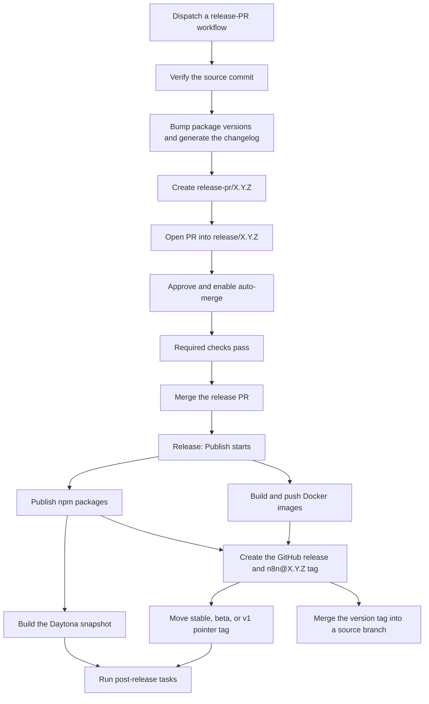

# Releasing n8n

n8n releases through GitHub Actions. A merged release pull request starts the main publication pipeline. Git tags identify the released commit and the current release tracks.

## The most important rule

**Do not push a tag to start a release.**

The main workflow, [`.github/workflows/release-publish.yml`](.github/workflows/release-publish.yml), runs when a PR is merged into a `release/*` branch. It has no `push.tags` trigger.

The pipeline creates the Git tag and GitHub release after npm and Docker publication succeed. Pushing `n8n@<version>` yourself bypasses this process and can make the tag point to unpublished or unverified code.

## Release flow at a glance



Closing an unmerged release PR cancels that release. The creation workflow enables auto-merge, so the release proceeds when its checks pass.

## Branches used by the release process

| Branch or ref | Purpose |
| --- | --- |
| `master` | Source for normal minor releases and ongoing development |
| `release-candidate/X.Y.x` | Source for patch releases on a specific minor version |
| `release/X.Y.Z` | Base branch for one release PR |
| `release-pr/X.Y.Z` | Contains the version and changelog commit for that release |
| `3.x` | Source for standalone version 3 releases |
| `exp/...` | Source for an experimental release with selected commits |

The release-PR workflow creates `release/X.Y.Z` at the selected source commit. It then creates `release-pr/X.Y.Z` with the version and changelog changes. The PR targets `release/X.Y.Z`.

After publication:

- A normal minor-release tag merges into `master`.
- A normal patch-release tag merges into its `release-candidate/X.Y.x` branch.
- A standalone version 3 tag fast-forwards into `3.x`.

These merges carry the version and changelog changes back into the relevant development branches.

## Release tracks and tags

The main tracks are `stable`, `beta`, and the legacy `v1` track. The code resolves each track tag to an `n8n@X.Y.Z` tag at the same commit.

| Tag or label | Type | Behavior |
| --- | --- | --- |
| `n8n@2.50.0` | Versioned Git tag and GitHub release | Identifies one release version. Treat it as immutable |
| `stable` | Movable Git tag and GitHub release | Points to the current stable version |
| `beta` | Movable Git tag and GitHub prerelease | Points to the current beta version |
| `v1` | Movable Git tag and GitHub release | Points to the current legacy version 1 release |
| `rc` | Temporary npm dist-tag | Prevents the initial `n8n` package publish from becoming `latest` automatically |
| `latest` on GitHub | GitHub release attribute, not a Git tag | Marks the release shown as latest |
| `latest` or `next` on npm | npm dist-tags, not Git tags | Select the package version installed by users |
| `latest`, `stable`, `next`, or `beta` on images | Container tags, not Git tags | Select the image version used by Docker or GHCR users |

The same word can refer to different systems. A Git tag, GitHub release attribute, npm dist-tag, and Docker tag require separate updates.

### How the code determines the track

`determine-version-info.mjs` reads the root `package.json` version and resolves the current `stable`, `beta`, and `v1` tags.

- If the new version has the same major and minor version as an existing track, the release is a patch for that track.
- If no track matches, the workflow expects the next minor beta release.
- A normal new beta must increment the current beta by one minor version.
- The normal pipeline rejects a major-version track change.
- Versions containing `-rc.` or `-exp` use the internal `rc` release type.

The internal `release_type=stable` means “not RC or experimental.” It does not mean that the release uses the stable channel. A regular beta release also has this release type.

A version with patch number zero is a minor release unless it is RC or experimental. Other versions use patch-release maintenance behavior.

## Creating a release PR

Use the GitHub Actions workflows in the upstream `n8n-io/n8n` repository. The workflows need protected environments, GitHub App credentials, registry credentials, and publication permissions. A fork does not have these resources by default.

### Minor release

Run **Release: Create Minor Release PR**.

This workflow:

1. Rejects a second minor release in the same ISO week unless `force` is selected.
2. Uses `master` as the source.
3. Calls the shared **Release: Create Pull Request** workflow with `release-type=minor`.
4. Sends a Slack notification after creating the PR.

The weekly schedule exists as commented-out configuration. Treat minor-release creation as manual unless the schedule is enabled again.

### Patch release

Run **Release: Create Patch Release PR** for `stable`, `beta`, or `v1`.

The workflow:

1. Resolves the track's current version tag and release-candidate branch.
2. Lists commits that exist on the release-candidate branch but not at the current release tag.
3. Ignores commits beginning with `ci:` when it decides whether a release is actionable.
4. Skips PR creation when there are no commits, or when only CI commits exist without `force`.
5. Creates a patch release PR from the release-candidate branch when needed.

**Release: Schedule Patch Release PRs** can create PRs for all three tracks. Its schedule is also commented out. Manual dispatch forces PR creation when commits exist, even if they are all CI commits.

### Experimental release

Run **Release: Create Experiment PR** with a space-separated list of commit SHAs.

The workflow:

1. Resolves the current `stable` tag.
2. Creates an `exp/...` branch from that stable version.
3. Cherry-picks the selected commits.
4. Creates a release PR with `release-type=experimental`.

An experimental version has the form `X.Y.Z-exp.g<short-sha>`. It does not receive normal stable or beta channel promotion.

### Standalone version 3 release

Use **Release: Create Pull Request** directly with:

- `base-branch=3.x`.
- `release-type=major`, `minor`, or `patch`.
- `prerelease=true`.

This path requires a bare version 3 SemVer, such as `3.1.0`. It verifies that the release descends from the current `3.x` branch. It skips normal channel promotion and stable-release maintenance. After publication, it fast-forwards the version tag into `3.x`.

The standalone path also skips the main `n8n` npm-package publish step. The other configured publication jobs, including workspace packages and Docker images, still run.

## Version and changelog generation

The shared release-PR workflow performs these actions:

1. Resolve and verify the exact source commit.
2. Run the blocking single-instance npm dependency verification for every publishable package.
3. Run `bump-versions.mjs`.
4. Run `update-changelog.mjs`.
5. Create the release branch and PR.
6. Approve the PR and enable auto-merge.

`bump-versions.mjs` uses the most recent `n8n@*` tag as its baseline.

- It bumps packages with changes since that tag.
- It propagates bumps to dependent workspace packages.
- It detects relevant root override and pnpm catalog changes.
- It always bumps the main `n8n` CLI package.
- It keeps the monorepo root version aligned with the CLI version.
- A major bump marks all publishable packages as changed.

Supported creation types are `patch`, `minor`, `major`, `experimental`, and `premajor`. `premajor` creates an RC version. Normal publication still applies its track-validation rules.

`update-changelog.mjs` uses Conventional Commits and the `n8n@` tag prefix. It prepends the new entry to `CHANGELOG.md` and creates `CHANGELOG-<version>.md`. The PR body receives the version-specific changelog.

Commits with `(no-changelog)` in the header are excluded. The `benchmark` and `engine` scopes are also excluded. Backport suffixes are removed from displayed commit subjects.

## What happens after the release PR merges

### 1. Determine release metadata

The publication workflow validates the source and computes:

- The new version.
- The previous version on that track.
- The release track.
- Patch or minor behavior.
- RC or experimental status.
- The release-candidate branch.
- Any previous beta version that should become stable.

A concurrency group serializes publication for the release base branch. It does not cancel an active release.

### 2. Publish npm packages

The npm job builds the workspace and runs dry-run publishes first. Before publication, it also:

- Trims frontend package metadata.
- Ensures provenance fields exist.
- Copies the root README into the CLI package.
- Sets the compiled default release channel.
- Passes the release version to the Vite build through `RELEASE`.

Publication uses npm trusted publishing through OIDC and enables provenance. The job runs in the `npm` GitHub environment.

Workspace packages publish before the main `n8n` package. pnpm skips package versions that already exist. This order supports retries after transient failures.

The main package initially publishes with the temporary `rc` dist-tag. The workflow then removes that tag. Later channel-promotion steps assign `next`, `beta`, `latest`, or `stable` explicitly. This prevents an initial publish from automatically becoming npm `latest`.

A new public package must first be configured with **Release: Setup Trusted Publishing for Package**. That workflow can create a throwaway setup version and connect the package to `release-publish.yml` in the `npm` environment. The first trusted publish must complete within two days.

### 3. Build and publish container images

In parallel with npm publication, `docker-build-push.yml` builds the application and multi-architecture images.

Release builds cover the `n8n` and `runners` images, including configured pointer-compressed, Debian, and distroless variants. Versioned images go to GHCR and Docker Hub. The release also creates SHA-based image references and provenance, VEX, and SBOM attestations.

The initial image tags contain the exact version. Channel image tags are added later by the channel-promotion workflow.

### 4. Create GitHub releases and the version tag

After npm and Docker publication succeed, `release-create-github-releases.yml` creates a release named `n8n@<version>`. GitHub creates the corresponding tag at the release branch.

The PR body supplies the release notes.

- Beta releases are marked as prereleases.
- RC and experimental releases are marked as prereleases.
- A stable-track release can become GitHub `latest`.
- The workflow also creates or recreates the track-named GitHub release when applicable.

The GitHub release waits for both npm and Docker publication. This avoids announcing a version before its main artifacts exist.

### 5. Move the Git track pointer

For non-RC releases, `release-update-pointer-tag.yml` force-updates the track tag to the new version tag:

```text
stable -> n8n@X.Y.Z
beta   -> n8n@X.Y.Z
v1     -> n8n@X.Y.Z
```

Only the selected track moves. RC and experimental releases skip this step.

On a minor release, the workflow also moves `stable` to the previous beta version. The new minor remains the beta, and the previous minor becomes stable.

The pointer workflow verifies that the target version tag exists. It then uses `git tag -f` and a force push to update only the track tag.

### 6. Merge the tag into the source branch

The release tag merges into `master` after a minor release or into `release-candidate/X.Y.x` after a patch release. A standalone version 3 release uses a fast-forward-only merge into `3.x`.

This operation happens after GitHub creates the version tag. It is separate from moving the channel pointer.

### 7. Generate the SBOM and build the Daytona snapshot

The pipeline generates and attaches an SBOM to the GitHub release. It also builds a Daytona snapshot after npm publication. Post-release tasks require the snapshot job to succeed.

## Channel promotion and post-release tasks

`release-publish-post-release.yml` coordinates the remaining work.

### Current release channel

For a regular stable release, **Release: Push to Channel** assigns:

- npm `latest` and `stable` to the new `n8n` version.
- Docker Hub and GHCR `latest` and `stable` to the matching `n8n` and `runners` images.

For a regular beta release, it assigns:

- npm `next` and `beta`.
- Docker Hub and GHCR `next` and `beta`.

It also calls the documentation webhook that updates latest/next references. That webhook step continues on error.

The channel workflow accepts only numeric SemVer with an optional suffix. It explicitly blocks `-rc.` versions from stable or beta promotion.

### Minor-release promotion

A normal minor release also:

- Promotes the previous beta to npm and container `stable`/`latest`.
- Marks the previous minor's GitHub release as `latest`.
- Promotes backport labels for the new minor.

This two-version operation is intentional. The new minor is beta while the previous minor becomes stable.

### Other maintenance

Depending on the release type, the pipeline also:

- Ensures release-candidate branches exist for current stable and beta versions.
- Removes the branch for the minor two versions behind current stable.
- Re-pins stable workspace packages to npm `latest` after relevant stable, beta, and minor releases.
- Records the release in Cloud databases and marks experimental releases when applicable.
- Sends version-release notifications for non-RC releases.
- Publishes the Public API schema when stable changes.
- Sends Slack notifications for release failures.

## Failure handling and recovery

First inspect the failed job in **Release: Publish**. Retry failed jobs for transient registry or infrastructure failures. Workspace package publication is designed to skip versions that already exist.

Do not move version tags or publish replacement artifacts manually.

If a release reached npm and cannot resume safely, use **Release: Recreate failed release**. npm versions are immutable. This recovery path skips the failed version and releases the same code under the next patch version.

The recovery workflow:

1. Validates the failed `X.Y.Z` version.
2. Checks out its `release/X.Y.Z` branch.
3. Verifies the npm state and computes the next patch.
4. Creates a new release branch and PR for the replacement.
5. Approves and auto-merges the PR.

Use `force` only to skip the npm registry check when the registry itself is unreliable. Do not rerun the standalone-package version-bump job after its commit has already been pushed; that would bump the version twice.

## Standalone package releases

Some packages release independently of the main n8n version. **Release: Standalone Package** currently supports:

- `@n8n/create-node`.
- `@n8n/eslint-plugin-community-nodes`.
- `@n8n/scan-community-package`.

Run it from `master` with a patch or minor bump. It commits the package version to `master`, builds that package and its dependencies, and publishes it to npm.

This path uses token authentication rather than the main pipeline's OIDC trusted-publishing relationship. If publication fails after the version commit, rerun only the publish job.

## Useful inspection commands

These commands inspect release state. They do not start a release:

```bash
# List version tags in SemVer order
git tag --list 'n8n@*' --sort=-version:refname

# Resolve the commit behind a track tag
git rev-parse 'stable^{}'
git rev-parse 'beta^{}'

# Find the version tag at the same commit as stable
git tag --points-at "$(git rev-parse 'stable^{}')" --list 'n8n@*'

# Inspect one release
git show n8n@2.50.0

# Check tags on the remote without changing local refs
git ls-remote --tags origin 'n8n@*' stable beta v1
```

Fetch tags before local inspection when your clone does not have the latest release refs.

## Main implementation files

- [`.github/workflows/release-create-pr.yml`](.github/workflows/release-create-pr.yml): shared release-PR creation.
- [`.github/workflows/release-create-minor-pr.yml`](.github/workflows/release-create-minor-pr.yml): minor-release entry point and cadence check.
- [`.github/workflows/release-create-patch-pr.yml`](.github/workflows/release-create-patch-pr.yml): patch-release entry point.
- [`.github/workflows/release-publish.yml`](.github/workflows/release-publish.yml): main publication orchestrator.
- [`.github/scripts/bump-versions.mjs`](.github/scripts/bump-versions.mjs): workspace version calculation.
- [`.github/scripts/update-changelog.mjs`](.github/scripts/update-changelog.mjs): changelog generation.
- [`.github/scripts/determine-version-info.mjs`](.github/scripts/determine-version-info.mjs): track and release-type detection.
- [`.github/scripts/create-github-release.mjs`](.github/scripts/create-github-release.mjs): version and track GitHub releases.
- [`.github/scripts/move-track-tag.mjs`](.github/scripts/move-track-tag.mjs): movable Git tag updates.
- [`.github/workflows/release-create-github-releases.yml`](.github/workflows/release-create-github-releases.yml): GitHub release wrapper.
- [`.github/workflows/release-update-pointer-tag.yml`](.github/workflows/release-update-pointer-tag.yml): pointer-tag workflow.
- [`.github/workflows/release-push-to-channel.yml`](.github/workflows/release-push-to-channel.yml): npm and container channel aliases.
- [`.github/workflows/release-publish-post-release.yml`](.github/workflows/release-publish-post-release.yml): post-release orchestration.
- [`.github/workflows/release-merge-tag-to-branch.yml`](.github/workflows/release-merge-tag-to-branch.yml): version-tag merges.
- [`.github/workflows/release-recreate-failed-release.yml`](.github/workflows/release-recreate-failed-release.yml): failed-release recovery.
- [`.github/workflows/docker-build-push.yml`](.github/workflows/docker-build-push.yml): container build and publication.
- [`.github/scripts/docker/docker-tags.mjs`](.github/scripts/docker/docker-tags.mjs): container tag generation.
