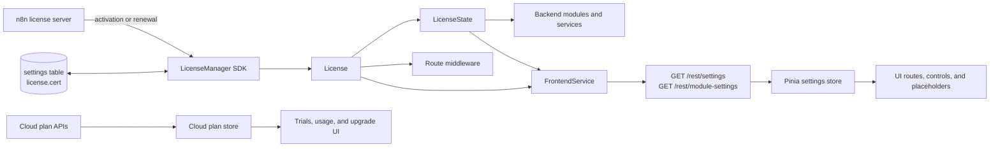

# Subscription plans and editions

n8n offers hosted subscriptions and self-hosted editions. The available features depend on the deployment type, the subscription, the license entitlements, and the n8n version.

The [pricing page](https://n8n.io/pricing/) is the source of truth for current prices, limits, and feature bundles. This document summarizes the plans and explains how the repository applies them.

## Plans at a glance

| Plan or edition | Deployment | Cost | Main purpose |
| --- | --- | --- | --- |
| Free trial | n8n Cloud | Free for 14 days | Try n8n Cloud with Pro features |
| Starter | n8n Cloud | Paid | Individuals and small projects |
| Pro | n8n Cloud | Paid | Power users and small teams that need more capacity and collaboration |
| Community | Self-hosted | Free | Run almost the complete product on your own infrastructure |
| Registered Community | Self-hosted | Free | Community with extra features after email registration |
| Business | Self-hosted | Paid | Teams that need SSO, environments, Git version control, and scaling |
| Enterprise | Cloud or self-hosted | Paid, contact sales | Advanced security, scaling, governance, and support |

Every option runs the same underlying product. Cloud removes infrastructure maintenance. Self-hosting gives the operator control over installation, configuration, updates, and infrastructure.

## How charging and limits work

Paid subscriptions primarily scale with workflow executions. One execution is one complete workflow run. The number of nodes or steps in that run does not change the execution count.

The current pricing model includes unlimited workflows, workflow steps, and users. Plans still differ in areas such as:

- Monthly execution allowance.
- Concurrent executions.
- Shared projects.
- Insights and execution-history retention.
- AI Assistant credits and other AI entitlements.
- Security, collaboration, scaling, and support features.

The exact numbers can change. Check the pricing page before making a purchasing decision.

## n8n Cloud plans

Cloud plans apply to instances hosted by n8n. n8n manages the infrastructure and updates.

### Free trial

The Cloud free trial lasts 14 days and provides Pro features. No credit card is required to start. Trial data includes an expiration date and usage limits. The editor can show remaining time and execution usage.

### Starter

Starter is the entry-level paid Cloud plan. Its current headline features include:

- Agents, MCP, and AI nodes.
- AI models without separate API keys.
- A monthly AI Assistant credit allowance.
- One shared project.
- Five concurrent executions.
- Forum support.

### Pro

Pro includes Starter and adds higher limits and more team functionality. Its current headline additions include:

- Three shared projects.
- Up to 50 concurrent executions.
- Seven days of insights.
- A higher AI Assistant credit allowance.
- Admin roles.
- Metric-based evaluations.
- Workflow history.

### Enterprise on Cloud

Enterprise includes Business-level functionality and adds the highest security, scaling, retention, and support options. See [Enterprise functionality](#enterprise) below. Cloud Enterprise is hosted by n8n.

## Self-hosted editions and plans

### Community

Community is the default free edition. It runs without a license key and includes almost the complete n8n feature set.

Community does not include the full paid feature set. Notable paid areas include workflow and credential sharing, projects, SSO, environments, external secrets, external binary-data storage, log streaming, Git version control, and multi-main mode. Availability can differ between Cloud and self-hosted plans.

### Registered Community

Registered Community is a free Community edition with extra entitlements. The user registers an email address and receives a license key.

The documented extra features are:

- Folders for workflow organization.
- Debug in editor, including copying and pinning execution data.
- Custom execution data.

The registration dialog in this repository also describes advanced debugging and execution search and tagging. The issued license determines the final entitlement set. n8n states that the included features can change, but features already unlocked remain available.

Register through **Settings > Plan & usage > Unlock**, or during initial account creation when that option is available.

### Business

Business is a paid, self-hosted plan. The current pricing page describes it as including Pro functionality plus:

- Six shared projects.
- SSO and LDAP.
- Thirty days of insights.
- AI Assistant in preview.
- Multiple environments.
- Queue mode for scaling.
- Git-based version control.
- Forum support.

Business fills the gap between Community and Enterprise for organizations that need collaboration, security, and scaling without the full Enterprise bundle.

### Enterprise

Enterprise is available as Cloud or self-hosted. It includes Business functionality plus the most advanced options. The current headline additions include:

- Unlimited shared projects.
- At least 200 concurrent executions, subject to the selected contract and infrastructure.
- 365 days of insights.
- External secret-store integration.
- End-user credentials in preview.
- Log streaming.
- Extended data retention.
- Dedicated support with a service-level agreement.
- AI Assistant preview on request.

An Enterprise subscription supplies a license key. A Cloud subscription can also use n8n-managed hosting.

### Startup and older plans

The source code and tests can recognize names such as `Startup` and `Enterprise Trial`. n8n also has a separate Startup offer for eligible early-stage companies. These names do not form another universal feature tier in the application. The license server supplies the actual entitlements and quotas. Older instances and licenses can therefore show limits or bundles that differ from the current pricing page.

## Functionality controlled by licenses

The repository does not contain a fixed `Community -> Pro -> Business -> Enterprise` feature matrix. Instead, a license certificate contains feature flags and numeric quotas. The license server can change these values without an application release.

The main licensed capability groups are:

| Area | Examples of licensed capabilities |
| --- | --- |
| Collaboration and access | Workflow and credential sharing, team projects, admin/editor/viewer project roles, advanced permissions, custom roles, folders, personal-space policies, and workflow reviews |
| Identity and security | LDAP, SAML, OIDC, SCIM, MFA enforcement, API-key scopes, token exchange, dynamic credentials, trusted-source management, data redaction, and node or credential type policies |
| Development and operations | Variables, Git source control, external secrets, workflow diffs, named versions, log streaming, advanced execution filters, debug in editor, execution limits, and custom npm registries |
| Scaling and storage | S3 or Azure binary data, S3 or Azure execution data, multiple main instances, worker view, and worker pools |
| AI | AI Assistant, AI Builder, AI credits, Gateway credits, Cloud usage-based billing entitlements, and the legacy Ask AI flag |
| Insights | Summary, dashboard, and hourly-data access, with separate history and retention quotas |

This list describes capabilities that the code can gate. It does not state that every paid plan includes every item. Some capabilities also require environment configuration, an active backend module, a suitable n8n version, or a feature-preview opt-in.

`feat:apiDisabled` is a restriction flag rather than an unlocked feature. It allows a license to disable the public API.

## Numeric quotas

Licenses can set these quotas independently of the plan name:

- Users.
- Active workflows or active workflow triggers.
- Variables.
- Team projects.
- AI credits and Gateway credits budget.
- Workflow-history pruning.
- Insights history, retention age, and pruning interval.
- Workflows with evaluations.
- Evaluation concurrency.

A value of `-1` means unlimited. Missing values use feature-specific defaults. For example, team projects default to zero and AI credits default to zero. Most user, active-workflow, and variable limits default to unlimited when the license does not specify them.

Evaluation concurrency has an explicit tier fallback when neither an environment override nor a license quota exists:

| Plan name | Default concurrent evaluations |
| --- | ---: |
| Community | 1 |
| Pro | 1 |
| Business | 3 |
| Enterprise | 5 |
| Unknown or other plan | 1 |

`N8N_CONCURRENCY_EVALUATION_LIMIT` overrides the license quota. The license quota overrides the tier fallback.

Cloud also has a separate plan-data API. It exposes monthly execution, active-workflow, and credential limits, plus plan metadata and license features. These fields support current plans, trials, and older Cloud plans. Their presence in the API does not mean that every current plan still uses every limit.

## How the code implements plans and licenses

The application separates the commercial plan from runtime feature access. The license service issues a certificate. The certificate contains entitlements. The backend and frontend read those entitlements instead of deriving features from the plan name.



### Startup and certificate storage

`BaseCommand.initLicense()` performs the startup sequence in `packages/cli/src/commands/base-command.ts`:

1. Resolve `License` from the dependency-injection container.
2. Call `License.init()`.
3. Register `License` as the provider for `LicenseState`.
4. Activate `N8N_LICENSE_ACTIVATION_KEY` if the instance has no certificate.

`License.init()` creates a `LicenseManager` from `@n8n_io/license-sdk`. It supplies the license-server URL, tenant ID, n8n version, instance identity, certificate loaders, renewal callbacks, and usage-metric collectors.

A main process loads the certificate from the `license.cert` row in the settings table. `License.saveCertStr()` writes renewed certificates back to that row. Workers and other non-main processes initialize the SDK in offline mode. They use the stored certificate but do not renew it.

`N8N_LICENSE_CERT` supplies an ephemeral certificate instead. In that mode, the application does not read or write the database certificate.

The main license configuration lives in `packages/@n8n/config/src/configs/license.config.ts`:

| Environment variable | Purpose | Default |
| --- | --- | --- |
| `N8N_LICENSE_SERVER_URL` | License validation and renewal endpoint | `https://license.n8n.io/v1` |
| `N8N_LICENSE_ACTIVATION_KEY` | Key to activate when no certificate exists | Empty |
| `N8N_LICENSE_CERT` | Ephemeral certificate | Empty |
| `N8N_LICENSE_AUTO_RENEW_ENABLED` | Enable automatic renewal | `true` |
| `N8N_LICENSE_TENANT_ID` | Tenant type passed to the SDK | `1` |
| `N8N_LICENSE_DETACH_FLOATING_ON_SHUTDOWN` | Release floating entitlements on shutdown, except in multi-main | `true` |

### Feature and quota identifiers

`packages/@n8n/constants/src/index.ts` defines the shared identifiers:

- `LICENSE_FEATURES` contains boolean keys such as `feat:sharing`, `feat:ldap`, and `feat:sourceControl`.
- `LICENSE_QUOTAS` contains numeric keys such as `quota:users`, `quota:maxTeamProjects`, and `quota:evaluations:maxWorkflows`.
- `UNLIMITED_LICENSE_QUOTA` is `-1`.

This shared package lets the backend, frontend, and modules use the same keys. TypeScript restricts feature lookups to known identifiers.

### Reading entitlements

`License` in `packages/cli/src/license.ts` wraps the SDK and implements the `LicenseProvider` interface from `@n8n/backend-common`.

Its main read operations are:

- `isLicensed(feature)` calls `LicenseManager.hasFeatureEnabled()`.
- `getValue(feature)` calls `LicenseManager.getFeatureValue()`.
- `getCurrentEntitlements()` returns the active entitlement list.
- `getPlanName()` resolves the display name.
- `isEnterprisePlan()` checks for the exact backend plan name `Enterprise`.

`LicenseState` in `packages/@n8n/backend-common/src/license-state.ts` provides a safer application-facing API. Services inject it and call methods such as `isVariablesLicensed()`, `isSourceControlLicensed()`, or `getMaxTeamProjects()`. It also supplies defaults when a quota is absent.

An array of feature flags uses OR logic. For example, provisioning is licensed when either SAML or OIDC is licensed.

The SDK merges active entitlements. Feature overrides take precedence over base features. `getPlanName()` then applies extra rules for display:

- No valid certificate produces `Community`.
- The newest applicable named plan supplies the main plan name.
- An entitlement marked with `isMainPlan: false` is an add-on and does not replace the main plan.
- Registered Community does not replace an active paid plan.
- A `planName` feature override can produce names such as `Enterprise Trial`.

The usage endpoint uses `getMainPlan()` to obtain the main plan's product ID. Sales-led plans can lack the main-plan metadata, so the product ID and display-name selection are related but not identical operations.

Most runtime access checks use feature entitlements. They do not call `isEnterprisePlan()`. This design supports add-ons, custom contracts, trials, and older plans without a code change.

### Backend enforcement

The backend applies licenses at several layers.

**REST routes.** The `@Licensed(LICENSE_FEATURES.SOURCE_CONTROL)` decorator stores a feature key in the route metadata. `ControllerRegistry` converts that metadata into middleware. An unlicensed request receives HTTP 403 with `Plan lacks license for this feature`.

The Public API registry has equivalent middleware. It returns HTTP 403 with a `FeatureNotLicensedError` message. License middleware complements authentication and RBAC. It does not replace them.

**Backend modules.** A module can declare a license flag:

```ts
@BackendModule({
	name: 'external-secrets',
	licenseFlag: 'feat:externalSecrets',
})
export class ExternalSecretsModule {}
```

`ModuleRegistry.initModules()` skips initialization when the required flag is absent. Multiple flags use OR logic. The registry exposes active modules and module settings to the frontend. Module initialization can also depend on the process type and environment configuration.

**Services and commands.** Business logic checks entitlements when an operation needs more than route-level gating. It throws `FeatureNotLicensedError` for an unavailable feature. Startup commands also check licensed deployment modes, such as multi-main and worker pools.

**Quota checks.** Services compare current usage with the relevant numeric quota. Examples include:

- `VariablesService` checks `feat:variables` and `quota:maxVariables` before creating a variable.
- `ProjectService` passes `quota:maxTeamProjects` into team-project creation and throws an over-quota error when insertion fails.
- Evaluation services limit the number of workflows with evaluation configurations.
- `ConcurrencyControlService` resolves the evaluation concurrency limit and queues work above the limit.

This layering matters. Hiding a button is not sufficient enforcement. The backend must also reject an unlicensed request or operation.

### Frontend settings and UI gating

`FrontendService.getSettings()` in `packages/cli/src/services/frontend.service.ts` refreshes license-derived settings on every settings fetch. The settings include:

- The plan name and consumer ID.
- Boolean values under `FrontendSettings.enterprise`.
- Variables, team-project, evaluation, AI, and other quotas.
- The active-module list.
- Configuration-dependent combinations, such as a storage mode that must be both configured and licensed.

`FrontendService.getModuleSettings()` separately exposes settings from initialized modules. The editor fetches `/rest/settings` and `/rest/module-settings`. `useSettingsStore` stores the responses and exposes computed values such as `planName`, `isCommunityPlan`, `isEnterprisePlan`, and `isEnterpriseFeatureEnabled`.

The UI uses these values in three main ways:

- Components hide, disable, or annotate unavailable controls.
- The enterprise router middleware redirects users when required feature settings are absent.
- Licensed module placeholder pages appear when the module's license flag is off.

Frontend permission checks support `allOf` and `oneOf` feature combinations. These checks improve the user experience. The backend remains responsible for enforcement.

### Cloud-specific implementation

Cloud plan metadata supplements the license state. It does not replace entitlement checks.

`cloudPlan.store.ts` loads plan data only for an instance owner on a Cloud deployment with a Cloud user ID. It calls:

- `GET /admin/cloud-plan` for the plan name, trial state, expiration, metadata, and limits.
- `GET /cloud/limits` for active workflows and execution usage.
- Cloud proxy endpoints for account details, upgrade offers, and admin-panel login codes.

The store computes remaining workflows and executions. During a trial, it polls usage every five seconds. It stops polling when the trial expires or all executions are used. Banner configuration from the plan response controls trial messaging and upgrade actions.

This separate path explains why Cloud trial and billing UI can show fields that the self-hosted `LicenseState` API does not expose.

### Activation, renewal, and propagation

`LicenseController` exposes the license workflow under `/rest/license`:

| Endpoint | Action |
| --- | --- |
| `GET /` | Return plan and usage data |
| `POST /enterprise/request_trial` | Request an Enterprise trial |
| `POST /enterprise/community-registered` | Register Community and request a free key |
| `POST /activate` | Activate a key, with EULA acceptance when required |
| `POST /renew` | Renew the license and return a management token |

The mutation endpoints require the `license:manage` global scope. Activation returns updated plan data and a management JWT. The Plan & usage page uses that token to construct the subscription-management URL.

For the user, the activation flow is:

1. Start n8n without a key to use Community.
2. Register Community or buy a paid subscription to receive an activation key.
3. Open **Settings > Plan & usage** and select **Enter activation key**.
4. Accept the license agreement when the activation flow requires it.
5. Restart n8n when prompted so all licensed features become available.

Automatic renewal is enabled by default. `LicenseRenewalTask` calls `License.renewIfDue()` on the SDK schedule. The SDK configuration uses a 72-hour renewal offset. Manual renewal is a no-op when the plan is Community.

After renewal or an entitlement change, the main process saves the certificate and notifies refresh callbacks. AI clients use these callbacks to update their certificate. In queue mode, the application broadcasts `reload-license`. Other processes then reload the stored certificate without renewing it themselves.

During renewal, `LicenseMetricsService` collects usage for the license server. The metrics include active and total workflows, enabled and total users, credentials, production and manual executions, active workflow triggers, and workflows with evaluations.

A missing, invalid, or expired certificate makes the instance report `Community`. Boolean feature checks return false, and numeric queries use their fallback values.

### Example: variables from license to UI

The variables feature shows the complete path:

1. `LICENSE_FEATURES.VARIABLES` defines `feat:variables`.
2. `LICENSE_QUOTAS.VARIABLES_LIMIT` defines `quota:maxVariables`.
3. The license certificate supplies values for those keys.
4. `LicenseState.isVariablesLicensed()` and `getMaxVariables()` expose them to services.
5. `VariablesService` rejects creation when the feature is off or the quota is exhausted.
6. `FrontendService` publishes the feature state and limit in the settings response.
7. The editor uses those settings to show or hide variable-creation UI.

Other licensed features follow the same pattern, with route or module gates added when needed.

## Where to check the current plan

Open **Settings > Plan & usage**. The page shows:

- The current plan or edition.
- Active workflow-trigger usage and its limit.
- Options to enter an activation key, view plans, or manage the subscription.

For Cloud, the owner can also use the Cloud admin panel and trial or usage banners. The frontend obtains Cloud plan details from `/admin/cloud-plan` and usage from `/cloud/limits`.

## Sources

Official product references:

- [n8n plans and pricing](https://n8n.io/pricing/)
- [Choose how to use n8n](https://docs.n8n.io/choose-how-to-use-n8n/)
- [Compare self-hosted editions](https://docs.n8n.io/hosting/community-edition-features/#registered-community-edition)
- [Startup plan](https://n8n.io/pricing/startup-plan/)
- [Explanation of execution-based pricing and unlimited workflows, steps, and users](https://blog.n8n.io/build-without-limits-everything-you-need-to-know-about-n8ns-new-pricing/)

Relevant implementation files:

- [`packages/@n8n/constants/src/index.ts`](packages/@n8n/constants/src/index.ts): license feature and quota identifiers.
- [`packages/@n8n/config/src/configs/license.config.ts`](packages/@n8n/config/src/configs/license.config.ts): license environment configuration.
- [`packages/cli/src/commands/base-command.ts`](packages/cli/src/commands/base-command.ts): process startup and provider registration.
- [`packages/cli/src/license.ts`](packages/cli/src/license.ts): SDK setup, certificate handling, plan selection, and feature lookup.
- [`packages/@n8n/backend-common/src/license-state.ts`](packages/@n8n/backend-common/src/license-state.ts): typed feature and quota queries.
- [`packages/@n8n/decorators/src/controller/licensed.ts`](packages/@n8n/decorators/src/controller/licensed.ts): route license metadata.
- [`packages/cli/src/controller.registry.ts`](packages/cli/src/controller.registry.ts): internal REST license middleware.
- [`packages/cli/src/public-api/public-api-controller.registry.ts`](packages/cli/src/public-api/public-api-controller.registry.ts): Public API license and user-quota middleware.
- [`packages/@n8n/decorators/src/module/module.ts`](packages/@n8n/decorators/src/module/module.ts): backend-module license declarations.
- [`packages/@n8n/backend-common/src/modules/module-registry.ts`](packages/@n8n/backend-common/src/modules/module-registry.ts): licensed module initialization.
- [`packages/cli/src/license/license.controller.ts`](packages/cli/src/license/license.controller.ts): license REST endpoints.
- [`packages/cli/src/license/license.service.ts`](packages/cli/src/license/license.service.ts): activation, renewal, registration, and usage responses.
- [`packages/cli/src/license/license-renewal.task.ts`](packages/cli/src/license/license-renewal.task.ts): scheduled renewal.
- [`packages/cli/src/metrics/license-metrics.service.ts`](packages/cli/src/metrics/license-metrics.service.ts): usage metrics sent during renewal.
- [`packages/cli/src/services/frontend.service.ts`](packages/cli/src/services/frontend.service.ts): license-derived frontend settings.
- [`packages/cli/src/evaluation.ee/evaluation-concurrency.helper.ts`](packages/cli/src/evaluation.ee/evaluation-concurrency.helper.ts): evaluation-concurrency precedence and tier defaults.
- [`packages/frontend/@n8n/stores/src/settings.store.ts`](packages/frontend/@n8n/stores/src/settings.store.ts): frontend plan and feature state.
- [`packages/frontend/@n8n/stores/src/cloudPlan.store.ts`](packages/frontend/@n8n/stores/src/cloudPlan.store.ts): Cloud plan, trial, and usage state.
- [`packages/frontend/@n8n/rest-api-client/src/api/cloudPlans.ts`](packages/frontend/@n8n/rest-api-client/src/api/cloudPlans.ts): Cloud plan metadata and usage APIs.
- [`packages/frontend/editor-ui/src/features/settings/usage/views/SettingsUsageAndPlan.vue`](packages/frontend/editor-ui/src/features/settings/usage/views/SettingsUsageAndPlan.vue): Plan & usage interface.
- [`packages/frontend/editor-ui/src/features/settings/usage/components/CommunityPlusEnrollmentModal.vue`](packages/frontend/editor-ui/src/features/settings/usage/components/CommunityPlusEnrollmentModal.vue): Registered Community enrollment interface.
